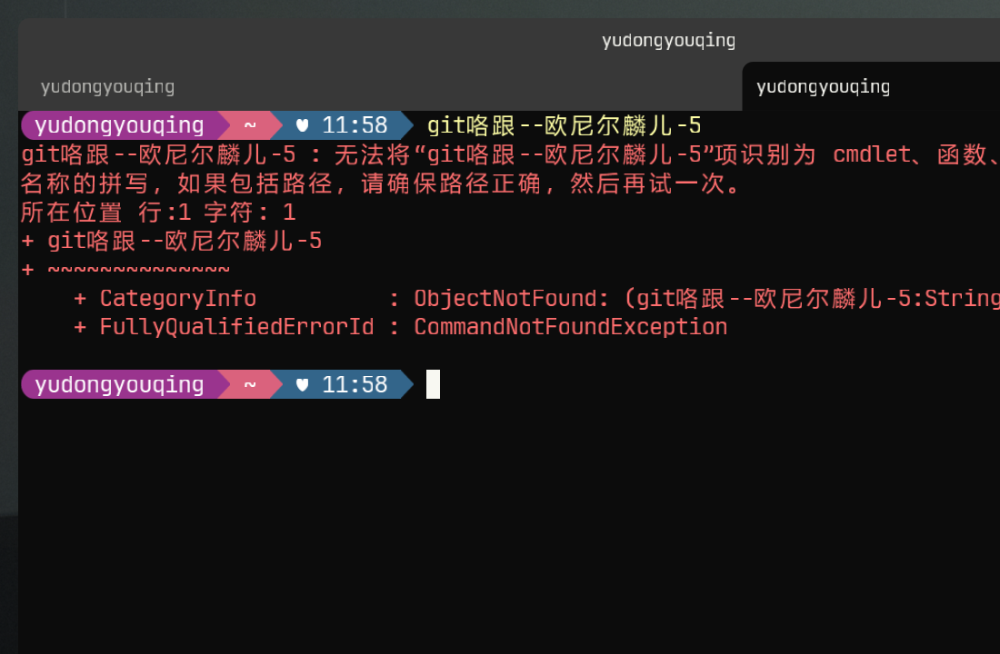

# Mica

**Windows 原生终端模拟器,Rust 打造。** 快得像你别平台羡慕的那些工具,原生得像你每天在用的那些。



> Mica [ˈmaɪkə] —— 得名于 Windows 11 的招牌材质,而窗口真的用它
> (`DWMWA_SYSTEMBACKDROP_TYPE`)。原生到名字里。

[English intro below 中文]

## 这是什么

Mica 是一个 **Windows 原生**终端模拟器,目标是把 Ghostty 在 macOS 上
验证过的三大支柱——**性能、功能、原生 UI**——完整带到 Windows:

- **性能**:Rust + wgpu(D3D12)GPU 渲染,ConPTY 直连,无 Electron /
  无 XAML 框架税;渲染吞吐有基准与 CI 门禁防退化
- **功能**:现代终端协议(kitty keyboard、synchronized output、
  OSC 8/52/133)、分屏、多标签、多窗口、Quick Terminal、
  Ghostty 语法兼容的配置与 630+ 主题生态
- **原生**:裸 Win32 + DWM——Mica 材质、暗色标题栏、系统级 IME
  (中文输入一等公民)、per-monitor DPI v2

受 [Ghostty](https://github.com/ghostty-org/ghostty) 架构哲学启发
(核心库 + 平台原生壳),与该项目**无隶属关系**;仅参考其行为与
协议语义,不复用其代码。

## What is this

A **Windows-native** terminal emulator bringing the three pillars Ghostty
proved on macOS — speed, features, native UI — to Windows: Rust + wgpu
(D3D12) rendering over ConPTY, bare Win32 + DWM chrome (real Mica
backdrop, dark titlebar, first-class IME, per-monitor DPI v2), modern
terminal protocols (kitty keyboard / synchronized output / OSC 8/52/133),
splits, tabs, multi-window and a Quick Terminal, with Ghostty-compatible
`key = value` config and its 630+ theme ecosystem. Inspired by Ghostty's
architecture; not affiliated with it.

## 窗口与标签 / Window & Tabs

- **双行标签栏**:第一行窗口标题 + 系统按钮,第二行标签 + `+`;
  单标签时标签行自动隐藏(上游 `hasTabBar` 同款)
- **标签拖拽换序**:按住标签横拖,手粘光标、邻位滑动让位、松手落定
  (挤压式,Chrome 语义)
- **tear-off**:把标签拖出标签行,撕成独立窗口(续同 shell / 工作目录)
- **多窗口**:Ctrl+Shift+N 随时开新窗,进程活到最后一窗
- **动画**:标签切换滑移、聚焦/失焦整条渐变洗白(时长可配,可关)
- **溢出滚动**:标签放不下时两端箭头 + 滚轮滚动,活跃标签自动跟随
- **Quick Terminal**:Win+\` 顶部下拉,失焦收起,exit 后横幅提示、
  唤出即重开

## 常用键位(Windows Terminal 兼容 + 浏览器直觉)

| 键 | 动作 |
|---|---|
| `Ctrl+T` / `Ctrl+Shift+T` | 新标签 |
| `Ctrl+Shift+W` | 关标签/分屏 |
| `Ctrl+Shift+1..9` | 跳标签 |
| `Ctrl+Tab` / `Ctrl+Shift+Tab` | 下一/上一标签 |
| `Ctrl+Shift+N` | 新窗口 |
| `Alt+方向` | 分屏间跳焦点 |
| `Ctrl+Shift+R` | 重开 shell(保留 cwd) |
| `Ctrl+Shift+↑/↓` | 上一/下一 prompt(OSC 133) |

## 配置

`%APPDATA%\mica\config`,**Ghostty 语法**,保存即热重载:

```ini
theme = Dracula
font-family = JetBrains Mono
font-size = 13

# 标签栏外观全量可配(strip-* 键集)
strip-font-size = 9.5
strip-bar-wash = 0.18          # 条底提亮(失焦自动洗白一档)
strip-tab-height = 36
strip-animation-duration = 120 # ms,0 = 关动画
```

颜色/字体/几何/动画共 17 个 `strip-*` 键,详见
`crates/mica-core/src/config/settings.rs` 文档注释。

## 状态 / Status

1.0 已发布(main = v1.0.0,Release 附 CI 产出的 MSI);1.1 打磨批次
进行中(标签栏重构 / 多窗口 / tear-off / 全量可配,见 #32)。

| 里程碑 | 内容 | 状态 |
|---|---|---|
| M0 骨架 | 三 crate 架构 + 核心层 + 渲染管线 + Win32 壳 + CI | ✅ |
| M1 渲染与配置 | DirectWrite 字形、CJK、配置与主题生态 | ✅ |
| M2 窗口体验 | 多标签、分屏、选择、快捷键体系 | ✅ |
| M3 系统集成 | Profile/IPC/WSL、Quick Terminal、安装包 | ✅ |
| M4 协议 | kitty keyboard、OSC 8/133、2026、graphics 预研 | ✅ |
| M5 1.0 | 健壮性(崩溃档案/DPI v2/IME)、发布 | ✅ |
| 1.1 打磨 | 标签栏/多窗口/tear-off/动画/全量可配 | 🚧 |

## 安装 / Install

- **MSI**:GitHub Releases 的 `mica.msi`(CI 产出,未签名——
  SmartScreen 提示选"仍要运行";个人项目暂不购代码签名证书)
- **winget**:清单投递待做(#36)
- **源码**:`cargo build --release`(Rust stable + Windows;
  `cargo run --bin mica` 直接跑)

开发提示:`mica --multi` 起隔离实例(绕过单实例,便于多开调试)。

## 构建 / Build

```bash
cargo run --bin mica          # Windows:真窗口
cargo test -p mica-core -p mica-render   # 核心与渲染层跨平台可测
cargo clippy --workspace --all-targets -- -D warnings   # CI 同款
```

## 架构 / Architecture

依赖方向严格单向:`mica-app` → `mica-render` → `mica-core`。

| crate | 职责 |
|---|---|
| `mica-core` | 终端状态机(alacritty_terminal)+ PTY(ConPTY)+ 键位编码与配置合成,零 GUI 依赖 |
| `mica-render` | 纯逻辑层(颜色/帧/字形图集/路由)+ wgpu 管线 + DirectWrite 光栅化 |
| `mica-app` | Win32 壳:消息循环、输入路由、DWM、系统集成 |

设计文档与实施计划见 `docs/superpowers/`。

## 崩溃档案

崩溃时自动在 `%LOCALAPPDATA%\mica\crashes\` 落 minidump(`.dmp`)+
panic 详情(`.txt`),弹窗提示路径。**永不上传**——发 issue 时可自行
决定是否附上 dmp 与对应版本 exe/pdb。

## 已知边界(如实陈述)

ConPTY 在 Windows 侧消费以下协议序列,终端侧管线正确但收不到源头
(直连 pty 场景即生效;边界移动由金丝雀测试看守):

- DECSET 2026(同步输出)—— ConPTY 自带缓冲兜底
- OSC 133(shell integration):**随 OS build 走**——≥26300 完整
  透传(prompt 跳转/退出码点可用),26100 及以下剥离
- kitty graphics 的 APC 载荷(不实现,预研文档在库)
- OSC 52(剪贴板,疑被拦截,tmux 复验在票)

OSC 8 超链接是唯一各版本实证透传的例外:下划线样式、Ctrl+Click
打开、悬停显示 URL 均可用。

## 许可 / License

`MIT OR Apache-2.0` 双许可,见 [LICENSE-MIT](LICENSE-MIT) 与
[LICENSE-APACHE](LICENSE-APACHE)。
