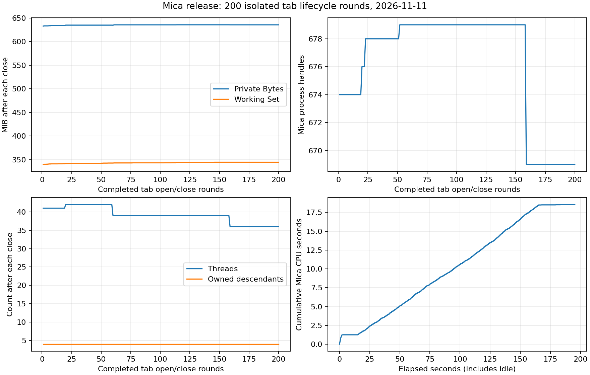

# Mica release：真实标签生命周期资源曲线

2026-11-11 在同一台 Windows 机器上先完成 5 轮探针，再完成 200 轮真实标签开关。200 轮全部通过：每轮关闭后均回到 **2 条 Running / 0 条 Closing 会话记录、4 个自有子进程**，没有累计标签、超限、CLI 失败或强制清理。主窗最终通过自己的 `WM_CLOSE` 正常退出，退出码为 0；404 个已持句柄核验的 child/host 身份全部退出，隔离 registry 最终为空。

本次短时曲线显示 Private Bytes 在预热后基本回稳；Working Set 后 100 轮仍有小幅增长，末 20 轮和结束静置已接近平坦。不能据此证明长期无泄漏，也不能计算相对修复前的提升比例。

## 固定版本和环境

- 源码：`19c9afd0c86276714266dbeca8b095800e3c8b71`。
- release EXE SHA-256：`6c57b860fb31428fbdd6bf20fb79f0fd6a5f8afcadcc07b8319d4368399da050`，10,255,360 字节。
- 构建：`cargo build --release -j2`，独立 `render-budget-target`；测量前已完成，测量期间没有并行 GPU/GUI 测试或构建。
- Windows 11 `10.0.26300.9711`；Intel Core i7-12650H，16 个逻辑 CPU，15.74 GiB 物理内存；NVIDIA RTX 4060 Laptop GPU，驱动 `32.0.16.1656`，DX12。
- 窗口正常可见，1462×1006 px，150% DPI，12 pt。首次铺帧前的启动样本可能尚不可见；200 个关闭后样本均可见。未最小化，也未使用全局输入。
- 每次运行独立 `APPDATA`、`LOCALAPPDATA`、`USERNAME`、PID。原样配置保存在各运行的 `isolation/mica/config`，关闭光标闪烁和 strip 动画；Delete 的全部 Ctrl/Alt/Shift/Win 组合均绑定 `close_tab`。
- 初始主标签和隐藏 QT 使用生产默认 PowerShell，因此加载了现有用户 profile，并在隔离目录产生 oh-my-posh 辅助缓存。这是当前用户环境的真实路径测量；这些第三方缓存不入 Git。Jump List COM 安装失败、QT 热键已占用的非致命日志原样保留。

## 方法与安全边界

启动静置采样 15 秒，确认延迟初始化完成后取基线。每轮通过 CLI `new-tab 'Command Prompt'` 新建标签，向 `--tab=1` 发送一条带少量中文的 `echo`，固定等待 300 ms，再向**本测试 PID、class=`mica_app_class`** 的 HWND 投递 `WM_KEYDOWN/VK_DELETE` 与 key-up。没有 `SendKeys`、`SendInput`、全局按键或按进程名清理。

每轮等待 registry 回到原来两个 child 身份且没有 Closing 记录；确认刚关闭标签的 child 和 host 均已退出，再固定等待 100 ms 取关闭后样本。registry 等待上限 10 秒，CLI 上限 8 秒；会话数超过 3、内存/句柄/线程异常增长或系统可用内存低于 2 GiB 即停止。完整阈值见 driver 和 `environment.json`。

每个 registry child/host 都以 PID + Windows FILETIME 核验并持有进程句柄；关闭后检查同一进程对象，不把 PID 复用误判为泄漏。正常结束等待 30 秒并采样，再发自有 HWND 的 `WM_CLOSE`。兜底仅允许仍活的自有 Popen 进程树，或同一已核验句柄上的终止；本次两组均未触发兜底。

## 200 轮结果

总计 **196.40 秒、1,246 个原始样本**。循环本身 150.54 秒，Mica 主进程累计 CPU 增量 17.234375 秒。结束静置的实际首末采样间隔 29.39 秒，CPU 增量 0.0625 秒。所有 401 次 CLI 调用退出成功。采样到的系统可用内存最低 4.07 GiB。

后 100 轮斜率为第 101–200 轮**关闭后**样本对轮数的普通最小二乘回归；峰值取全部阶段，包含新标签打开时。

| 主进程资源 | 启动基线 | 结束静置末值 | 全样本峰值 | 后 100 轮斜率 / 轮 |
| --- | ---: | ---: | ---: | ---: |
| Private Bytes | 627.28 MiB | 635.68 MiB | 685.84 MiB | −0.000442 MiB |
| Working Set | 332.82 MiB | 344.59 MiB | 352.91 MiB | +0.008139 MiB |
| Handles | 670 | 669 | 697 | −0.146175 |
| Threads | 40 | 36 | 47 | −0.043852 |
| 自有递归子进程数 | 4 | 4 | 6 | 0 |

Private Bytes 后 100 轮首末仅增加 **40 KiB**；回归略负来自期间的小幅释放，不能解释为优化收益。Working Set 后 100 轮首末增加 **1.19 MiB**，末 20 轮的范围仅 4 KiB；Private Bytes 末 20 轮完全相同。Working Set 受 OS 驻留策略影响，且 pilot 与正式运行基线明显不同，不能替代 Private Bytes 归因。句柄和线程在后段下降，子进程始终回到 4，未观察到逐轮累积会话或句柄。

5 轮 pilot：50.13 秒、76 样本；每轮相同 registry/子进程核验通过，14 个 child/host 身份全部退出，最终 registry 为空。它只用于验证夹具，正式统计以 200 轮为准。



## 复跑与原始文件

运行需要 Windows、Python、psutil；分析图还需要 matplotlib。选择**新的输出目录**，driver 拒绝覆盖已有运行目录。下例需替换 EXE 与源码 SHA：

```powershell
python tab_cycle_driver.py --exe C:/path/to/release/mica.exe --out fresh-pilot-5 --rounds 5 --source-head FULL_SOURCE_SHA
# 检查 pilot 的 result.json、registry 和退出事件成功后，再单独运行：
python tab_cycle_driver.py --exe C:/path/to/release/mica.exe --out fresh-main-200 --rounds 200 --source-head FULL_SOURCE_SHA
```

`pilot-5/` 与 `main-200/` 保留 CSV、逐轮 CLI/registry/退出事件、配置、环境、结果和 Mica stderr。`metrics.json` 由 `analyze_curves.py` 从原始 CSV 计算；脚本预期根目录下有这两个运行目录，并拒绝覆盖已有统计/图。`machine.json` 补充机器信息；EXE 不入库，两个运行的校验和一致。

没有修前同机对照，因此不宣称提升百分比。本次没有测 8 小时 soak、输入到屏幕 p95、物理 VRAM 或峰值持续输出吞吐；CJK 输入由 CLI 成功接收并固定等待，没有像素读回或呈现延迟测量。主进程计数不包含子进程内存总和，也没有采样间隙内瞬时峰值的保证。
